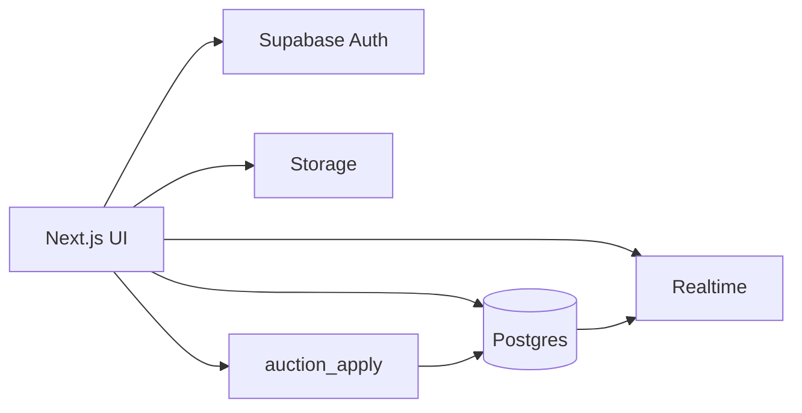
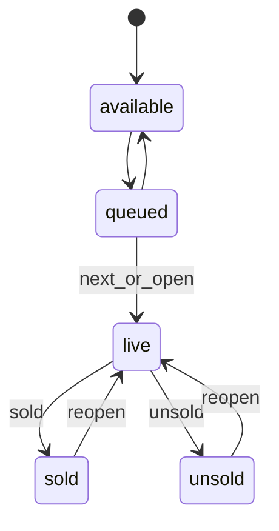

# Community Sports Auction Manager — Architecture

Status: implementation plan. No application code in this document.

Sources of truth, in order:

1. `Docs/WIREFRAMES.md` — screens and actions
2. `Docs/BUILD_PLAN.md` — stack, modules, phases, and rules
3. `Docs/BRD.md` — title only today. When the BRD is filled in, it overrides this plan where they disagree.

This plan is for apartment and community cricket auctions. The data model keeps `sport` as a field so a later tournament can be another sport without a new app.

## Assumptions

These are not written in the BRD. They follow the wireframes and the four build-plan rules.

- One organizer runs the auction from the Live Auction Room. Team buttons are clicked by that person. Phones do not bid on their own in the first release.
- A tournament has many teams and many players. A player is sold to at most one team.
- Purse is committed when the auctioneer marks a player **SOLD**. A bid does not reduce purse. **UNDO** and **REOPEN** of a sale put that money back.
- The highest legal bid for a team is its remaining purse. There is no “keep enough for the rest of the squad” rule in this release.
- The first bid on a player is the player’s base price. Each later click by a team raises the bid by the tournament bid increment.
- **UNSOLD** is allowed even if bids exist. Those bids stay in history and charge no purse.
- **NEXT PLAYER** is refused while a player is still live. The auctioneer marks Sold or Unsold first.
- **UNDO** reverses the latest auction action and every row that action changed. It is a stack, not an edit of an old row.
- Settings for purse, base price, and increment are copied onto a tournament when it is created. Changing community defaults does not rewrite a tournament already in progress.
- Light and dark theme is a device preference, not a database setting.
- Excel import creates players in one tournament. It does not create teams.

## 1. Application architecture

The app is a Next.js web client on Supabase. Postgres is the system of record. The browser never applies purse math on its own.



### Boundaries

| Layer | Responsibility |
| --- | --- |
| UI | Screens from the wireframes, forms, drag-and-drop queue, live room layout |
| Server reads | Load tournament, teams, players, and reports through the logged-in Supabase session |
| `auction_apply` | The only writer for bid, sold, unsold, reopen, undo, and next player |
| Postgres | Constraints, row locks, and the event log |
| Realtime | Push committed rows to the auction room and any second screen |
| Storage | Player photos |

CRUD for tournaments, teams, players, and queue order uses normal table access under Row Level Security. Money movement does not.

### Tournament is the center

Every team, player, queue position, bid, and report row belongs to one tournament. The shell always has an active tournament. Sidebar links for Teams, Players, Auction Queue, Auction Room, and Reports open that tournament. Dashboard and Tournaments can exist with no tournament selected.

A community owns many tournaments. Users join a community with a role. They do not own teams or players directly.

### Live auction as one transaction

Each Live Auction Room action is one database transaction:

1. Lock the tournament row.
2. Lock the live player and the team being charged, when those rows exist.
3. Reject the action when the rule fails.
4. Write the new player, team, and event rows together.
5. Commit, then let Realtime notify listeners.

The client shows the button as pending until the transaction returns. A second click sends the same action id, and the database treats it as the first click.

### What each module owns

| Module | Owns | Does not own |
| --- | --- | --- |
| Dashboard | Counts for the active tournament and shortcuts | Auction rules |
| Tournaments | Name, sport, status, copied purse settings | Team rosters |
| Teams | Name, color, purse total, purse remaining, purchased players | Bids |
| Players | Identity, role, photo, base price, status, sold team | Queue order writes during a live lot |
| Excel import | Parse, preview, commit new players | Updates to sold players |
| Auction queue | Order of players not yet sold | Purse |
| Live auction room | Current lot, bids, timer display, sold / unsold / reopen / undo / next | Tournament setup |
| Reports | Read models over sold players and team purses | New bids |
| Settings | Community name and default numbers for the next tournament | The live tournament’s numbers |

### Tournament status

| Status | Meaning |
| --- | --- |
| `draft` | Teams and players can be edited. Auction room actions are refused. |
| `ready` | Setup is complete enough to start. At least one team and one queued player. |
| `live` | Auction room actions are accepted. Team and player deletes are refused. |
| `completed` | No further bids. Reports and export stay available. Reopen of the tournament is an explicit action back to `live`. |

Starting the auction sets `live`. Completing it sets `completed` only when no player is `live`.

### Player status



A tournament has at most one player in `live`.

Sold means `team_id` and `sold_price` are both set. Every other status has both empty. That is a database constraint, which is what enforces “a player belongs to only one team.”

### Bid rules inside `auction_apply`

For `bid`:

- Tournament status is `live`.
- A player is `live`.
- The team belongs to that tournament.
- If nobody has bid on this lot, the amount is the player’s base price.
- If someone has bid, the amount is the current bid plus the tournament increment.
- The amount is less than or equal to that team’s `purse_remaining`.
- The click is stored even when the same team is already leading. Each click is a new amount.

For `sold`:

- There is a leading bid.
- `purse_remaining` is reduced by the sold price.
- The player’s team is the leading team.

For `unsold`:

- Purse does not change.
- The player’s team stays empty.

For `reopen`:

- The player is `sold` or `unsold`.
- No other player is `live`.
- A sold player’s price is added back to that team’s purse, then the team link is cleared.
- The player becomes `live` again. The previous leading bid is still the current bid.

For `undo`:

- Load the latest event for the tournament that is not itself an undo and has not already been reversed.
- Write back the player and team snapshots stored on that event.
- Insert an undo event that points at the reversed event.

For `next`:

- No player is `live`.
- The next player is the queued player with the lowest `queue_position`.
- That player becomes `live` and an opening event is stored.

The timer is display-only. The opening event stores the server time. The browser counts down from `timer_seconds` on the tournament. Expiry does not auto-sell.

### Read path for reports

Reports read committed columns. They do not replay the event log.

- Auction summary: counts by player status, total spent, total remaining purse.
- Team spending: `purse_total - purse_remaining`, plus the sold players for that team.
- Remaining purse: `teams.purse_remaining`.
- Export: the same rows as CSV from the browser.

### Second screen

The auction room subscribes to `teams`, `players`, and `auction_events` for one tournament. A projector can open the same route read-only. It updates only after commit. It is not a second writer.

## 2. Folder structure

App Router, TypeScript, Tailwind, and shadcn/ui. Supabase clients stay in one lib folder so server and browser cookies are not mixed.

```text
Auction Mnager/
  Docs/
    BRD.md
    WIREFRAMES.md
    BUILD_PLAN.md
    ARCHITECTURE.md
  src/
    app/
      (auth)/
        login/
        signup/
      (app)/
        layout.tsx
        page.tsx
        tournaments/
        settings/
      layout.tsx
      globals.css
    components/
      ui/
      layout/
      dashboard/
      tournaments/
      teams/
      players/
      queue/
      auction/
      reports/
      settings/
    features/
      tournaments/
      teams/
      players/
      import/
      queue/
      auction/
      reports/
      settings/
    lib/
      supabase/
        client.ts
        server.ts
        middleware.ts
      validation/
      utils.ts
    types/
      database.ts
  supabase/
    migrations/
    seed.sql
  middleware.ts
  components.json
```

Rules for that tree:

- `app/` holds routes and layouts only. A page imports a feature component and renders it.
- `components/ui/` is shadcn. Do not put auction rules there.
- `components/<module>/` is presentation: cards, tables, the three-column auction room.
- `features/<module>/` holds query keys, form schemas, and the functions that call Supabase.
- `features/auction/` is the only feature allowed to call `auction_apply`.
- `lib/validation/` holds the same numbers the database checks, for form messages. The database remains the authority.
- `types/database.ts` is generated from Supabase after migrations exist.
- Photos go to Storage. The player row stores the object path, not a binary.

## 3. Next.js route structure

Routes under `(app)` require a session. Routes under `(auth)` are for signed-out users.

The active tournament is in the URL. Refresh and a shared projector link keep the same tournament.

```text
/login
/signup

/                                  Dashboard for the last opened tournament
/tournaments                       Tournament list
/tournaments/new                   Create tournament
/tournaments/[tournamentId]        Tournament dashboard

/tournaments/[tournamentId]/teams
/tournaments/[tournamentId]/teams/[teamId]

/tournaments/[tournamentId]/players
/tournaments/[tournamentId]/players/new
/tournaments/[tournamentId]/players/import
/tournaments/[tournamentId]/players/[playerId]

/tournaments/[tournamentId]/queue
/tournaments/[tournamentId]/auction
/tournaments/[tournamentId]/reports
/settings                          Community profile and default purse, base price, increment
```

Sidebar mapping:

| Sidebar label | Route |
| --- | --- |
| Dashboard | `/` |
| Tournaments | `/tournaments` |
| Players | `/tournaments/[tournamentId]/players` |
| Teams | `/tournaments/[tournamentId]/teams` |
| Auction Queue | `/tournaments/[tournamentId]/queue` |
| Auction Room | `/tournaments/[tournamentId]/auction` |
| Reports | `/tournaments/[tournamentId]/reports` |
| Settings | `/settings` |

The sidebar header shows the active tournament name and a switcher. Players, Teams, Queue, Auction Room, and Reports stay disabled until a tournament is selected.

Page contents follow the wireframes.

| Route | On the page |
| --- | --- |
| `/` | Current tournament, total teams, total players, players sold, players remaining, quick actions |
| `/tournaments` | List with name, sport, status |
| `/tournaments/[tournamentId]` | Name, sport, status, teams created, players registered, auction progress, links to teams, players, queue, and start auction |
| `.../teams` | Team cards: remaining purse, players purchased. Card opens team details |
| `.../players` | Search, import Excel, add player, table |
| `.../queue` | Drag-and-drop order, current player, upcoming players |
| `.../auction` | Left: player photo, role, base price. Center: current bid, leading team, bid history, timer, team bid buttons. Right: purse, players purchased, maximum possible bid. Actions: Sold, Unsold, Reopen, Undo, Next player |
| `.../reports` | Auction summary, team spending, remaining purse, export |
| `/settings` | Community information, default purse, base price, bid increment, theme |

`/` redirects to `/tournaments` when the user has no tournament yet. After they open one, `/` remembers it in a cookie named `active_tournament_id`.

Server Components load the first view of dashboard, lists, and reports. Client Components are the queue board, the auction room, search-as-you-type, theme toggle, and import preview.

## 4. Supabase database schema

Postgres on Supabase. Money is `numeric(12,2)`. Identifiers are `uuid`. Timestamps are `timestamptz`.

### Types

```sql
create type public.member_role as enum ('owner', 'auctioneer', 'viewer');

create type public.tournament_status as enum (
  'draft',
  'ready',
  'live',
  'completed'
);

create type public.player_status as enum (
  'available',
  'queued',
  'live',
  'sold',
  'unsold'
);

create type public.auction_event_type as enum (
  'player_opened',
  'bid',
  'sold',
  'unsold',
  'reopen',
  'undo'
);
```

### Identity and tenancy

```sql
create table public.profiles (
  id uuid primary key references auth.users (id) on delete cascade,
  display_name text not null,
  created_at timestamptz not null default now()
);

create table public.communities (
  id uuid primary key default gen_random_uuid(),
  name text not null,
  slug text not null unique,
  default_purse numeric(12,2) not null default 100000 check (default_purse >= 0),
  default_base_price numeric(12,2) not null default 1000 check (default_base_price >= 0),
  default_bid_increment numeric(12,2) not null default 500 check (default_bid_increment > 0),
  default_timer_seconds integer not null default 30 check (default_timer_seconds > 0),
  created_by uuid not null references public.profiles (id),
  created_at timestamptz not null default now()
);

create table public.community_members (
  community_id uuid not null references public.communities (id) on delete cascade,
  user_id uuid not null references public.profiles (id) on delete cascade,
  role public.member_role not null,
  created_at timestamptz not null default now(),
  primary key (community_id, user_id)
);
```

A profile row is created from a trigger on `auth.users`. The first community is created in onboarding, with that user as `owner`.

### Tournament, teams, players

```sql
create table public.tournaments (
  id uuid primary key default gen_random_uuid(),
  community_id uuid not null references public.communities (id) on delete cascade,
  name text not null,
  sport text not null default 'cricket',
  status public.tournament_status not null default 'draft',
  default_purse numeric(12,2) not null check (default_purse >= 0),
  base_price numeric(12,2) not null check (base_price >= 0),
  bid_increment numeric(12,2) not null check (bid_increment > 0),
  timer_seconds integer not null check (timer_seconds > 0),
  created_at timestamptz not null default now(),
  updated_at timestamptz not null default now(),
  unique (community_id, name)
);

create table public.teams (
  id uuid primary key default gen_random_uuid(),
  tournament_id uuid not null references public.tournaments (id) on delete cascade,
  name text not null,
  short_code text,
  color text,
  purse_total numeric(12,2) not null check (purse_total >= 0),
  purse_remaining numeric(12,2) not null check (purse_remaining >= 0),
  display_order integer not null default 0,
  created_at timestamptz not null default now(),
  unique (tournament_id, name),
  check (purse_remaining <= purse_total)
);

create table public.players (
  id uuid primary key default gen_random_uuid(),
  tournament_id uuid not null references public.tournaments (id) on delete cascade,
  team_id uuid references public.teams (id),
  full_name text not null,
  role text,
  photo_path text,
  base_price numeric(12,2) not null check (base_price >= 0),
  status public.player_status not null default 'available',
  sold_price numeric(12,2),
  queue_position integer,
  created_at timestamptz not null default now(),
  check (
    (
      status = 'sold'
      and team_id is not null
      and sold_price is not null
      and sold_price >= 0
    )
    or (
      status <> 'sold'
      and team_id is null
      and sold_price is null
    )
  )
);

create unique index players_one_live_per_tournament
  on public.players (tournament_id)
  where status = 'live';

create unique index players_queue_position_unique
  on public.players (tournament_id, queue_position)
  where queue_position is not null;

create index players_tournament_status_idx
  on public.players (tournament_id, status);

create index teams_tournament_idx
  on public.teams (tournament_id, display_order);
```

`team_id` on a sold player is the single roster link. There is no second squad table.

New teams copy `purse_total` and `purse_remaining` from `tournaments.default_purse`. A team can be given a different purse before the tournament goes `live`.

### Auction event log

This table is the undo record. Clients may select it. Clients may not insert it.

```sql
create table public.auction_events (
  id uuid primary key default gen_random_uuid(),
  tournament_id uuid not null references public.tournaments (id) on delete cascade,
  sequence bigint not null,
  action_id uuid not null,
  event_type public.auction_event_type not null,
  player_id uuid references public.players (id),
  team_id uuid references public.teams (id),
  amount numeric(12,2),
  snapshot jsonb not null,
  actor_id uuid references public.profiles (id),
  reverses_event_id uuid references public.auction_events (id),
  created_at timestamptz not null default now(),
  unique (tournament_id, sequence),
  unique (tournament_id, action_id)
);

create index auction_events_tournament_sequence_idx
  on public.auction_events (tournament_id, sequence desc);
```

`snapshot` stores the player row and any team purse rows from before the action. Undo writes those values back.

`action_id` comes from the browser. A double submit hits the unique key and returns the original event.

Leading bid for the open lot is the latest `bid` event for that player whose id is not referenced by `reverses_event_id`. The room also receives player and team row changes, so the sold card does not depend on a client reducing the numbers.

### Import batches

```sql
create table public.import_batches (
  id uuid primary key default gen_random_uuid(),
  tournament_id uuid not null references public.tournaments (id) on delete cascade,
  file_name text not null,
  status text not null check (status in ('preview', 'committed', 'failed')),
  row_count integer not null default 0,
  created_by uuid references public.profiles (id),
  created_at timestamptz not null default now()
);

create table public.import_rows (
  id uuid primary key default gen_random_uuid(),
  batch_id uuid not null references public.import_batches (id) on delete cascade,
  row_number integer not null,
  full_name text,
  role text,
  base_price numeric(12,2),
  error text,
  unique (batch_id, row_number)
);
```

Expected sheet columns: `name`, `role`, `base_price`. Empty base price uses the tournament base price. A row with no name is an error and is skipped on commit. Commit inserts players as `available` and marks the batch `committed`.

### Storage

Bucket: `player-photos`. Private.

Object path: `{community_id}/{tournament_id}/{player_id}`.

The player row keeps that path. The UI requests a short-lived signed URL.

### Row Level Security

Helper `public.is_community_member(community_id, roles)` reads `community_members` for `auth.uid()`.

| Table | Select | Insert / update / delete |
| --- | --- | --- |
| `profiles` | Own row, and members who share a community | Own row only |
| `communities` | Members | Owner updates. Insert only during onboarding |
| `community_members` | Members of that community | Owner manages rows |
| `tournaments`, `teams`, `players`, `import_*` | Members | Owner and auctioneer |
| `auction_events` | Members | No direct writes. `auction_apply` is `security definer` |

Extra policies:

- Delete of a team is refused when `tournaments.status` is `live` or any player points at that team.
- Delete of a player is refused when status is `sold` or `live`.
- Update of `purse_remaining`, `players.team_id`, `players.sold_price`, and `players.status` to `live`, `sold`, or `unsold` is refused for the browser role. Those columns change only inside `auction_apply`. Queue position and profile fields stay editable by owner and auctioneer while the tournament is `draft` or `ready`. While `live`, queue edits are limited to players still `queued` or `available`.

`auction_apply` checks that `auth.uid()` is an owner or auctioneer of the tournament’s community, then locks and writes.

### Realtime

Add `teams`, `players`, and `auction_events` to the `supabase_realtime` publication. The client filters by `tournament_id`.

## 5. Authentication strategy

Supabase Auth with email and password. Session cookies through `@supabase/ssr`. `middleware.ts` refreshes the session and sends anonymous users from `(app)` routes to `/login`.

### Roles

| Role | Can |
| --- | --- |
| `owner` | Settings, members, tournaments, auction, reports |
| `auctioneer` | Tournaments, teams, players, queue, auction, reports. No community settings and no member changes |
| `viewer` | Read dashboard, lists, auction room, and reports. No writes and no `auction_apply` |

The first release needs `owner`. The schema includes `auctioneer` and `viewer` so a second laptop can watch without a later migration. The member-management screen can wait until after the roadmap below.

### Onboarding

1. Sign up creates `auth.users` and a `profiles` row.
2. The app asks for a community name once.
3. The app inserts `communities` and a `community_members` row with role `owner`.
4. Later visits land on `/`.

There is no anonymous auction. There is no social login in the first release.

### Authorization checks

- Middleware only checks that a session exists.
- Row Level Security checks community membership.
- `auction_apply` checks owner or auctioneer again, so a viewer with a forged request still fails.

Service-role keys stay on the server and are not used for normal user actions. The browser uses the user session.

## 6. State management strategy

Server data stays in Supabase. The client cache shows it. Local component state is for inputs, drag previews, and the visible countdown.

| Concern | Where it lives |
| --- | --- |
| Session | Supabase cookies |
| Active tournament | The URL, plus cookie `active_tournament_id` for `/` |
| Tournament, teams, players, reports | TanStack Query, keyed by tournament id |
| Live room updates | Supabase Realtime invalidates those query keys |
| Auction commands | `useMutation` calling `auction_apply`. No optimistic purse change |
| Queue drag | Local order while dragging. Save the full order on drop |
| Search and table filters | The query string |
| Theme | `next-themes` on the document. Default `system` |
| Form drafts | Component state, validated with Zod |

Do not add Redux or a global auction store. Two writers would disagree with the database.

Query keys:

- `['tournament', tournamentId]`
- `['teams', tournamentId]`
- `['players', tournamentId, filters]`
- `['events', tournamentId]`
- `['reports', tournamentId]`

The auction room, on a Realtime event, invalidates `teams`, `players`, and `events` for that tournament. The countdown is derived from the latest `player_opened` or `reopen` event time plus `timer_seconds`. It resets when that event id changes.

Bid buttons read `purse_remaining` from the latest teams query. The label can show the disabled reason (“over purse”, “no live player”). The click still sends the command, and the server message is what the UI shows if the row changed between render and click.

Import preview is held in memory after the file is parsed in the browser. Commit sends the accepted rows once. The preview is not a second source of truth after commit.

## 7. Development roadmap

Phases match `Docs/BUILD_PLAN.md`. A phase starts when the previous phase’s checks pass. Do not build the auction room against mocked purse math.

### Phase 1 — Foundation

- Next.js, TypeScript, Tailwind, shadcn/ui, Supabase project.
- Folder tree, route shells, sidebar, auth screens, protected layout.
- Migrations for profiles, communities, members, tournaments, teams, players, events, and import tables.
- RLS policies and the `auction_apply` function signature. The function can return “not implemented” for each action until Phase 5, but the tables and grants exist now.
- Generated `types/database.ts`.

Done when a new user can sign up, create a community, and open an empty tournament shell.

### Phase 2 — Tournaments and teams

- Create and list tournaments. Copy community defaults onto the tournament.
- Tournament dashboard counts.
- Team cards, create, edit, reorder, purse total.
- Block team delete once a player is sold to that team.

Done when two tournaments in one community stay isolated, and a team shows remaining purse equal to its total before any sale.

### Phase 3 — Players and Excel

- Add, edit, search, and table.
- Photo upload to `player-photos`.
- Import preview with row errors, then commit.
- Status stays `available` until the player is queued.

Done when a sheet with one bad row imports the valid rows and reports the bad row. A player row has either no team or exactly one sold team.

### Phase 4 — Auction queue

- Drag-and-drop among `queued` players.
- Persist `queue_position` as a single ordered write.
- Show the current live player and the upcoming list.
- Moving a player between available and queued.

Done when a refresh shows the same order, and two players cannot share a position.

### Phase 5 — Live auction room

Implement `auction_apply` for open, bid, sold, unsold, reopen, undo, and next.

- Team buttons bid in increments.
- Center panel shows current bid, leading team, and history.
- Right panel shows purse, purchased players, and maximum possible bid, which is `purse_remaining`.
- Sold reduces purse. Unsold does not.
- Undo restores player status, team link, sold price, and purse.
- One live player per tournament.
- Realtime subscription so a second browser on the same route follows the first.

Done when this sequence passes in one tournament:

1. Open the first queued player.
2. Two teams bid. The second bid is current plus increment.
3. A bid above purse is rejected and changes nothing.
4. Sold assigns the player to the leader and reduces only that purse.
5. Undo restores the player to live and restores the purse.
6. Unsold clears the lot with no purse change.
7. Reopen brings that player back to live.
8. Next is rejected while a player is live, then opens the following queued player after Sold or Unsold.

### Phase 6 — Reports and export

- Summary counts, team spending, remaining purse.
- CSV export of teams and of sold and unsold players.
- Numbers match `teams` and `players` after Phase 5 actions, including after undo.

Done when a sold-then-undo tournament shows the player as unsold or live again and the purse back at the pre-sale value.

### Phase 7 — Theme, polish, performance

- Light, dark, and system theme on Settings.
- Empty states from the wireframes, button pending states, and readable errors from `auction_apply`.
- Indexes already listed are in place. Lists paginate only if a tournament passes a few hundred players.
- Pass over the auction room on a laptop width and a projector width.

Done when a full auction can be run from queue to report without using the Supabase dashboard.

## Build order inside a phase

1. Migration and constraints.
2. RLS check with two users, or owner and viewer, if both roles exist.
3. Feature function.
4. Page.
5. The phase’s done checks.

UI work does not start a phase. The constraint that protects purse and single-team ownership does.

## Out of scope for this plan

- Online bidding from each team’s own phone.
- Payments, entry fees, and player contacts beyond name, role, and photo.
- Minimum squad size or reserved purse for remaining slots.
- Automatic sale when the timer hits zero.
- Public internet access without an account.
- More than one community per user in the first UI. The tables already allow it.

When the BRD adds any of those, update this document before changing the schema.
