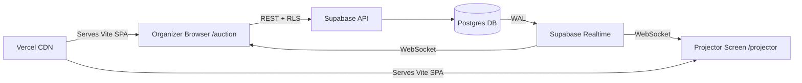

# Community Sports Auction Manager — Architecture

Status: **Implemented & Deployed** (Live on Vercel + Supabase).

## 1. Tech Stack

| Layer | Technology |
| --- | --- |
| **Frontend** | React 19, TypeScript, Vite, Tailwind CSS v4 |
| **Routing** | `react-router-dom` (`BrowserRouter` + `vercel.json` SPA rewrites) |
| **State Management** | React Context (`src/context/AuctionContext.tsx`) + `localStorage` preferences |
| **Excel / CSV** | SheetJS (`xlsx`) for `.xlsx`, `.xls`, and `.csv` import & template export |
| **Database & Sync** | Supabase PostgreSQL + Supabase Realtime (`postgres_changes` over WebSockets) |
| **Hosting & CI/CD** | Vercel (auto-deploys from `technologists07/Auction-Manager` on GitHub) |

## 2. System Overview



- **Organizer Console:** Runs all tournament setup, team/player management, queue ordering, and live auction controls (`/auction`).
- **Projector Mode (`/projector`):** Opens in a new browser tab without the sidebar or header, listening to Supabase Realtime so bids, `SOLD`, and `UNSOLD` banners update live.
- **Database as Source of Truth:** All tournaments, teams, players, and bids persist in Supabase Postgres; `AuctionContext` enforces auction rules before writing and refreshes subscribed clients automatically.

## 3. Folder Structure

```text
Auction Mnager/
  Docs/
    ARCHITECTURE.md
    BRD.md
    BUILD_PLAN.md
    WIREFRAMES.md
  src/
    components/
      ChartCard.tsx
      Header.tsx
      Icon.tsx
      PageTitle.tsx
      SettingsSection.tsx
      Sidebar.tsx
      StatCard.tsx
      TeamDrawer.tsx
      TournamentModal.tsx
    context/
      AuctionContext.tsx
    data/
      mockData.ts
    lib/
      supabase.ts
    pages/
      AuctionRoomPage.tsx
      CommandCenterPage.tsx
      DashboardPage.tsx
      ImportPlayersPage.tsx
      PlayersPage.tsx
      ProjectorModePage.tsx
      QueuePage.tsx
      ReportsPage.tsx
      SettingsPage.tsx
      TeamDetailPage.tsx
      TournamentsPage.tsx
    types/
      auction.ts
    App.tsx
    index.css
    main.tsx
  index.html
  package.json
  tsconfig.json
  vercel.json
  vite.config.ts
```

## 4. Route Structure

| Route | Component | Purpose |
| --- | --- | --- |
| `/` | `DashboardPage` | Overview stats, active tournament switcher, quick actions, and auction progress |
| `/tournaments` | `TournamentsPage` | List, create, and switch between tournaments |
| `/overview` | `CommandCenterPage` | Active tournament progress, counts, quick actions, and recent outcomes |
| `/players` | `PlayersPage` | Search, add, edit, and delete players (with purse refund if a sold player is deleted) |
| `/import` | `ImportPlayersPage` | Drag-and-drop `.xlsx`/`.xls`/`.csv` import, validation preview, and `.xlsx` template download |
| `/teams` | `TeamDetailPage` | View all teams, add/edit/delete teams, inspect squad rosters, and edit initial team purse |
| `/queue` | `QueuePage` | Drag-and-drop and arrow-button queue ordering with moved-row highlight and Up Next preview |
| `/auction` | `AuctionRoomPage` | Live bidding console, custom bids, purse/cap guardrails, SOLD/UNSOLD/UNDO/REOPEN/NEXT |
| `/projector` | `ProjectorModePage` | Full-screen live audience display with SOLD / UNSOLD overlay banners |
| `/reports` | `ReportsPage` | Auction progress charts, team spending breakdown, and CSV export |
| `/settings` | `SettingsPage` | Community branding, tournament rules, max player bid cap, theme toggle, JSON backup/restore, and Reset Tournament |

## 5. Supabase Database Schema

Four core tables in `public` schema, all added to the `supabase_realtime` publication:

1. **`tournaments`**: `id`, `name`, `season`, `status` (`draft | live | completed`), `total_purse`, `max_squad_size`, `min_bid_increment`, `current_player_id`, `current_bid`, `highest_bidder_team_id`, `created_at`
2. **`teams`**: `id`, `tournament_id` (cascade), `name`, `short_name`, `captain_name`, `total_purse`, `remaining_purse`, `color`, `created_at`
3. **`players`**: `id`, `tournament_id` (cascade), `name`, `role`, `category`, `base_price`, `sold_price`, `status` (`queued | live | sold | unsold`), `team_id`, `queue_order`, `stats`, `created_at`
4. **`bids`**: `id`, `tournament_id` (cascade), `player_id` (cascade), `team_id` (cascade), `amount`, `created_at`

## 6. Implemented Auction & App Rules

- **Bidding & Purse Guardrails:** Bids cannot exceed a team's `remaining_purse` or the configured **Max Player Bid Cap** (`localStorage` per tournament). Purse is deducted only when a player is marked **SOLD**.
- **Undo & Reopen:** `UNDO` deletes the latest bid on the live player and restores the previous bid/leader. `REOPEN` restores the exact last finished (`sold` or `unsold`) player back to `live` and refunds their `sold_price` to the winning team if they were sold.
- **Reset Tournament:** Clears all `bids` for the active tournament, resets all `players` to `queued`, restores every team's `remaining_purse` to `total_purse`, and sets tournament `status` back to `draft`.
- **Preferences & Theme:** Dark mode is the default (`localStorage` key `auctionpro_theme`), and Community Name / Primary Color are stored locally and applied on **Save Changes** in Settings.
- **Environment Variables:** `VITE_SUPABASE_URL` and `VITE_SUPABASE_PUBLISHABLE_KEY` (configured in `.env` locally and Vercel Environment Variables in production).
